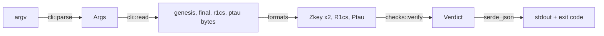

# Architecture

How `ceremony-verifier` is built. For running it, see [USAGE.md](USAGE.md); for changing it, see [DEVELOPMENT.md](DEVELOPMENT.md). The security rationale behind each decision is in [SPEC §8.4](https://github.com/orbinum/ceremony/blob/main/docs/SPEC.md).

## Principles

- **Independent.** Only arkworks 0.5 (`ark-bn254`, `ark-ec`, `ark-ff`), RustCrypto hashes, `rand`, `serde`/`serde_json` and `libc`. No code from snarkjs, ffjavascript or `groth16-proofs`. What snarkjs derives deterministically is reproduced from its observed behaviour and checked against snarkjs output (`tests/verifier/compat.rs`).
- **Fail closed.** Anything that cannot be verified is a failure:
  - an input that does not parse;
  - a value outside its range;
  - an encoding snarkjs would not write.

  A false rejection is visible; a false acceptance is not.

- **One encoding per key.** Containers, section orders, parameter layouts and field encodings must be exactly what snarkjs writes, so a key has a single SHA-256.
- **Bounded.** Every allocation and loop is bounded by an already validated size or a fixed cap (inputs ≤ 128 MiB, ≤ 10,000 MPC entries, beacon ≤ 2^24 hashes). No `unsafe`; release builds abort on arithmetic overflow; no `unwrap`/`expect`/`panic!` outside tests.

## Modules

One responsibility per directory, each with a `mod.rs` that re-exports its public items. `lib.rs` exposes the library; `main.rs` and `cli/` are the binary only.

| Module          | Responsibility                                                                                                                                                                                                                                       | Depends on                             |
| --------------- | ---------------------------------------------------------------------------------------------------------------------------------------------------------------------------------------------------------------------------------------------------- | -------------------------------------- |
| `cli/` (binary) | Strict argv (`args.rs`); input files opened with `O_NOFOLLOW \| O_NONBLOCK`, checked on the descriptor, read with a cap (`input.rs`)                                                                                                                 | the library                            |
| `formats/`      | Strict readers for the binary formats: binfile container (`binfile.rs`), bounded cursor (`reader.rs`), field elements and points (`field.rs`), zkey (`zkey.rs`), r1cs (`r1cs.rs`), ptau (`ptau.rs`)                                                  | `error`                                |
| `compat/`       | Exact reproductions of snarkjs's deterministic derivations: ChaCha stream, `fromRng`, `hashToG2`, the transcript and `h_k`, the beacon key, the genesis's fixed parts (coeffs, H, csHash) and wasmcurves' integer arithmetic for one over-read point | `formats`, `error`                     |
| `checks/`       | Every check of a final key against its genesis, and of the genesis against r1cs + ptau; one file per concern (`header`, `genesis`, `chain`, `sections`, `pairing`, `msm`) and `mod.rs` running them in order                                         | `compat`, `formats`, `report`, `error` |
| `report/`       | The JSON verdict: checks with stable ids, MPC entries with `h_k`                                                                                                                                                                                     | —                                      |
| `error/`        | One error type: `Format` (not a well-formed file) or `Invalid` (well formed, unacceptable value)                                                                                                                                                     | —                                      |

Dependencies only point downwards in this table: `formats` never sees `checks`, and `compat` never decides what is acceptable.

## Data flow

1. `cli::parse` refuses any ambiguous argv (exit 2). `cli::read` refuses symlinks, FIFOs and oversized files (exit 2).
2. `checks::verify` parses both zkeys. If either fails, `well-formed` carries the cause and every other check is reported as "not run", so the caller always gets the full id set.
3. The checks run in a fixed order. Each one records its problems, or none. `Verdict::finish` sets `ok` only if every check passed.
4. `main` writes the verdict. A write failure exits 2.

## Where each check lives

| Id                | Stage | Code                                                                   | How                                                                                                                                                                                                     |
| ----------------- | ----- | ---------------------------------------------------------------------- | ------------------------------------------------------------------------------------------------------------------------------------------------------------------------------------------------------- |
| `well-formed`     | A     | `formats/zkey.rs` (`Zkey::parse`), `checks/mod.rs` (`layout_problems`) | Container (version 1, sections 1–10 once each, no trailing bytes, snarkjs section order), canonical fields, curve and subgroup membership, sizes from the header, MPC parameters as snarkjs writes them |
| `genesis-start`   | A     | `checks/header.rs`                                                     | δ = 1, γ = generator, no entries                                                                                                                                                                        |
| `genesis-source`  | B     | `checks/genesis.rs`, `compat/genesis.rs`, `compat/wasm.rs`             | ptau pin and section sizes → r1cs bounded by 2^power → header, coeffs and H byte for byte → IC/A/B1/B2/C by random linear combination → csHash recomputed                                               |
| `unchanged`       | A     | `checks/header.rs`                                                     | Byte equality with the genesis                                                                                                                                                                          |
| `policy`          | A     | `checks/mod.rs`                                                        | Contribution count, one beacon last, announced value and iterations                                                                                                                                     |
| `chain`           | A     | `checks/chain.rs`, `compat/transcript.rs`, `compat/beacon.rs`          | Incremental transcript; proof of knowledge and δ ratio by pairing; no repeated δ; beacon key derived for the last entry only; stops at the first broken entry                                           |
| `final-delta`     | A     | `checks/mod.rs`                                                        | δ1 = last δ, `e(g1, δ2) = e(δ1, g2)`, δ ≠ γ, δ ≠ 1                                                                                                                                                      |
| `scaled-sections` | A     | `checks/sections.rs`                                                   | One random linear combination per section: `e(Σ rᵢGᵢ, g2) = e(Σ rᵢFᵢ, δ2)`                                                                                                                              |

## Design decisions

| Decision                                                                                     | Why                                                                                                                                  | Reference             |
| -------------------------------------------------------------------------------------------- | ------------------------------------------------------------------------------------------------------------------------------------ | --------------------- |
| Random linear combinations with 128-bit scalars for L, H and the Stage B sums                | Per-point pairings would cost hours; a wrong point passes with probability ≈ 2⁻¹²⁸ (snarkjs uses 32-bit scalars for L)               | SPEC §8.4, KL-15      |
| ptau pinned by BLAKE2b-512 in code, then section sizes checked against its power             | Stage B trusts the ptau's points (no subgroup check on the Lagrange G2 points); the pin makes that sound and bounds every allocation | KL-16                 |
| snarkjs's H-hash over-read reproduced with wasmcurves' 256-bit arithmetic (`compat/wasm.rs`) | At d = 2^power, snarkjs hashes bytes past ptau section 2 that are not field elements; modular arithmetic would give another csHash   | SPEC §8.4, A11, KL-10 |
| Incremental transcript and early stop in the chain                                           | Linear cost in the number of entries; a broken link makes every later entry meaningless                                              | CEREMONY_PLAN R3      |
| Every δ along the chain must be new                                                          | Cancelling contributions (x, then 1/x) would count towards the minimum while the beacon alone set δ                                  | CEREMONY_PLAN S1, KL-4 |
| Stable check ids, the full set always reported                                               | The CLI requires the exact set, so a build that skips a check never passes; a parse failure still names its cause                    | Stages C–E            |
| Stricter than snarkjs                                                                        | One encoding per key; a false rejection is visible, a false acceptance is not                                                        | KL-24                 |
